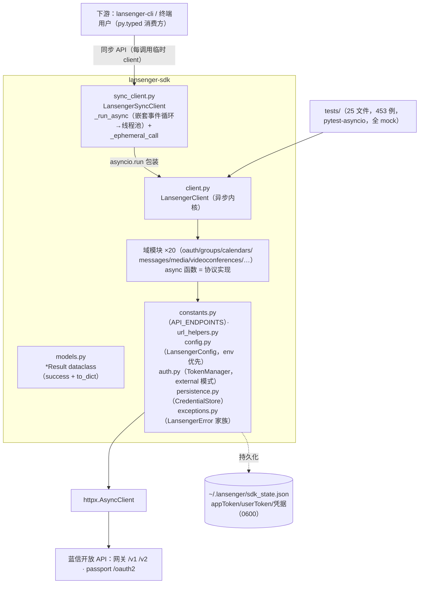

# 架构（docs/architecture.md）

> 定位：Harness ③结构层。模块地图 + 依赖方向 + **跨模块/跨仓契约同步清单**。
> 事实源：源码实读（client.py / sync_client.py / models.py / constants.py / config.py / auth.py / url_helpers.py，2026-10-13）+ 实测（453 passed）。

## 1. 架构图

## 2. 模块职责与模式

| 模块 | 职责 | 关键契约 |
|---|---|---|
| `client.py` | 异步内核：域方法主实现，共享 httpx client + TokenManager | 公共签名 = py.typed 契约（C4'） |
| `sync_client.py` | 同步门面：`_run_async`（检测运行中事件循环→线程池提交，支持 Jupyter/嵌套）+ `_ephemeral_call`（按调用临时建 client，用后即弃） | 方法签名必须与 Client 镜像 |
| `models.py` | `*Result`：`success` + `to_dict()`；CLI 的 `output_result` 直接消费 | C2' |
| `constants.py` | `API_ENDPOINTS`（app_token/oauth2/calendars/… 全端点） | C1' |
| `auth.py` | appToken 生命周期：GET /v1/apptoken/create（grant_type=client_credential）；external 模式直通不刷新 | app_secret 只经内存/env，禁落日志 |
| `persistence.py` | `CredentialStore`：profile 隔离持久化到 `~/.lansenger/sdk_state.json` | 文件含真实凭据，禁读取值 |
| `url_helpers.py` | URL 组装唯一入口（app_token/user_token 走 query 参数） | 禁裸拼 URL |

**依赖方向**：`sync_client → client → 域模块 → infra（constants/url_helpers/models/exceptions/config）→ httpx`。域模块之间禁止互相 import（与 CLI commands 层同纪律）。

## 3. 跨模块/跨仓契约同步清单（改动任一项必须全链路同步）

| # | 契约 | 定义处 | 联动点 |
|---|---|---|---|
| C1' | **端点总表** `API_ENDPOINTS` | constants.py | 域模块实现 · README ×6 · **ts/go SDK 对齐登记**（C7'） · 下游 CLI 文档 |
| C2' | **结果类模式** `*Result`（success + to_dict；snake_case） | models.py | client/sync_client 透传签名 · README ×6 · 下游 CLI `output_result` fields |
| C3' | **双错误包裹兼容**：网关 `errCode/errMsg` + OAuth2 `error:{code,message,detail?}`（detail 可缺省——实测 9004 无 detail） | exceptions.py + 各域 | 错误分类逻辑 · 下游 CLI 的 deviceflow_unsupported 判定（双端共用同一优先级分类表：成功 → errCode 包裹 → 404 → 重定向 → 已知码集 → 灰区，未知形态一律保守判不支持） |
| C4' | **py.typed 公共签名** | 所有公共 API | 破坏性变更 = `feat!:` + CHANGELOG + 下游评估 |
| C5' | **版本三元组** tag `v*` == pyproject `version` == `__init__.__version__` | release.yml 硬校验 | 发版同 PR 三处改齐 + CHANGELOG |
| C6' | **下游下限联动** | lansenger-cli pyproject `lansenger-sdk>=X` | 升下限 = CLI 全量回归 44 例 + CLI CHANGELOG `dep:` |
| C7' | **三语言协议对齐**（go/ts） | 三仓同协议 | 协议变更三仓联动，或交付报告显式登记不同步及理由（历史先例：`对齐 ts putJiabanFile`） |
| C8' | **README ×6 同步**（md/zhHans/zhHant/zhHantHK/fr/pypi） | 根目录 | 新端点/方法/字段/破坏性变更逐份同步；漏一份即文档漂移 |
| C9' | **日志红线**：logger 任何级别不得输出 token/secret 值 | auth.py / client.py 等 | `--verbose` DEBUG 场景（下游 CLI 复用本 SDK 日志）——新增日志语句须自查 |

## 4. 测试分层映射

| 层 | 落位 | 现状 |
|---|---|---|
| 单元/域 | `tests/test_<域>.py`（mock httpx 层） | 24 域文件，覆盖齐 |
| 同步包装 | test_sync_client_tokens.py / test_client_tokens.py | ✅ |
| 持久化/配置 | test_persistence.py / test_config.py | ✅ |
| 缺口 | mypy 静态层（py.typed 已发布但无自检）；sync/client 签名镜像无 lint 强制（演进项：加一致性测试） | — |

## 5. 运行时视图（推断标注）

- 凭证解析优先级：构造参数 > 环境变量 `LANSENGER_*`（config.py create）> CredentialStore 缓存。
- appToken：2h 有效期，提前 5min 自动刷新（TokenManager）；`config.app_token` 外部模式直通。
- userToken 刷新链路：`refresh_user_token` → `/v1/refresh_token/create`，成功后由**调用方**（CLI）落库——SDK 不擅自持久化 userToken（test_persistence 只测 store 本身）。
